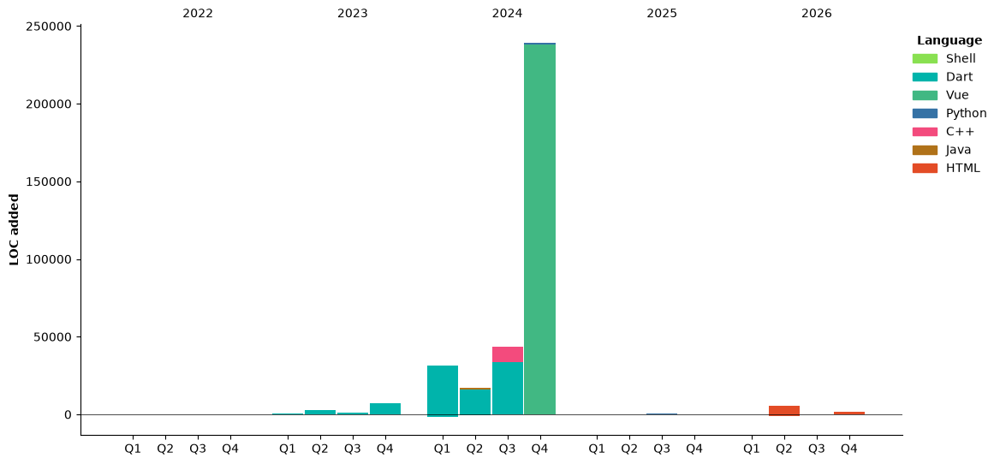

## 个人介绍
Ciallo～(∠・ω< )⌒★ 你好！我的网名是Shiro，译为白，所以你也可以直接叫我白。

### 我的爱好

* 喜欢看 轻小说/番剧
* 喜欢吃 包子/蒸饺/馄饨
* 喜欢摸 ~~萝莉~~

## 开发环境
[](https://www.microsoft.com/windows/get-windows-11)
[](https://www.apple.com/hk/en/macos/sonoma/)
[](https://www.debian.org/)
[](https://almalinux.org/)
[](https://www.microsoft.com/windows-server)

[](https://www.asus.com.cn/laptops/for-creators/vivobook/vivobook-pro-16-oled-k6602/)
[](https://www.apple.com/hk/en/mac-studio/)
[](https://www.mi.com/)
[](https://www.sony.com.hk/zh/headphones/products/wf-1000xm4)
[](https://www.yubico.com/hk/product/yubikey-5-nfc/)

[](https://code.visualstudio.com/)
[](https://code.visualstudio.com/)
## 我的Gayhub
[]()
[]()

<!--START_SECTION:waka-->


**🐱 My GitHub Data** 

> 📦 623.0 kB Used in GitHub's Storage 
 > 
> 🏆 84 Contributions in the Year 2026
 > 
> 🚫 Not Opted to Hire
 > 
> 📜 23 Public Repositories 
 > 
> 🔑 10 Private Repositories 
 > 
**I'm an Early 🐤** 

```text
🌞 Morning                38 commits          █████░░░░░░░░░░░░░░░░░░░░   18.72 % 
🌆 Daytime                70 commits          █████████░░░░░░░░░░░░░░░░   34.48 % 
🌃 Evening                84 commits          ██████████░░░░░░░░░░░░░░░   41.38 % 
🌙 Night                  11 commits          █░░░░░░░░░░░░░░░░░░░░░░░░   05.42 % 
```
📅 **I'm Most Productive on Friday** 

```text
Monday                   35 commits          ████░░░░░░░░░░░░░░░░░░░░░   17.24 % 
Tuesday                  26 commits          ███░░░░░░░░░░░░░░░░░░░░░░   12.81 % 
Wednesday                36 commits          ████░░░░░░░░░░░░░░░░░░░░░   17.73 % 
Thursday                 31 commits          ████░░░░░░░░░░░░░░░░░░░░░   15.27 % 
Friday                   38 commits          █████░░░░░░░░░░░░░░░░░░░░   18.72 % 
Saturday                 15 commits          ██░░░░░░░░░░░░░░░░░░░░░░░   07.39 % 
Sunday                   22 commits          ███░░░░░░░░░░░░░░░░░░░░░░   10.84 % 
```


📊 **This Week I Spent My Time On** 

```text
🕑︎ Time Zone: Asia/Hong_Kong

💬 Programming Languages: 
Other                    7 hrs 31 mins       ██████████████████████░░░   89.57 % 
Markdown                 17 mins             █░░░░░░░░░░░░░░░░░░░░░░░░   03.50 % 
TypeScript               9 mins              ░░░░░░░░░░░░░░░░░░░░░░░░░   01.98 % 
JSON                     8 mins              ░░░░░░░░░░░░░░░░░░░░░░░░░   01.69 % 
HTML                     8 mins              ░░░░░░░░░░░░░░░░░░░░░░░░░   01.68 % 

🔥 Editors: 
Chrome                   7 hrs 34 mins       ███████████████████████░░   90.19 % 
VS Code                  48 mins             ██░░░░░░░░░░░░░░░░░░░░░░░   09.61 % 
Copilot CLI              0 secs              ░░░░░░░░░░░░░░░░░░░░░░░░░   00.15 % 
Opencode Cli             0 secs              ░░░░░░░░░░░░░░░░░░░░░░░░░   00.05 % 
OpenCode                 0 secs              ░░░░░░░░░░░░░░░░░░░░░░░░░   00.00 % 

🐱‍💻 Projects: 
blog                     8 hrs 4 mins        ████████████████████████░   96.06 % 
email                    15 mins             █░░░░░░░░░░░░░░░░░░░░░░░░   03.07 % 
Unknown Project          4 mins              ░░░░░░░░░░░░░░░░░░░░░░░░░   00.87 % 

💻 Operating System: 
Windows                  8 hrs 24 mins       █████████████████████████   100.00 % 
```

🤖 **AI Coding This Week** 

```text
⏱ AI Coding Time: 33 mins (6.55%)

✍️ 365 lines written by AI, 2 lines written by hand (99.46% AI-written)

🔤 718,976 Input Tokens, 32,017 Output Tokens

💵 $4.00 Estimated AI Cost This Week

🧠 4 AI Sessions, 6 AI Prompts

GPT                      395 lines           █████████████████████████   100.00 % 
DeepSeek                 0 lines             ░░░░░░░░░░░░░░░░░░░░░░░░░   00.00 % 

🔎 AI Coding Insights:
🤖 AI-Driven — 99.46% of written lines came from AI
📝 Concise Prompter — average 450 characters per prompt
🔁 Iterative Prompter — average 2 prompts per session
🚀 High AI Trust — 1.74% of changed lines were hand-edited
```

**I Mostly Code in Dart** 

```text
Dart                     6 repos             █████████░░░░░░░░░░░░░░░░   35.29 % 
Python                   3 repos             ████░░░░░░░░░░░░░░░░░░░░░   17.65 % 
C++                      2 repos             ███░░░░░░░░░░░░░░░░░░░░░░   11.76 % 
HTML                     1 repo              █░░░░░░░░░░░░░░░░░░░░░░░░   05.88 % 
Vue                      1 repo              █░░░░░░░░░░░░░░░░░░░░░░░░   05.88 % 
```


**Timeline**




 Last Updated on 20/11/2026 00:47:29 UTC
<!--END_SECTION:waka-->
